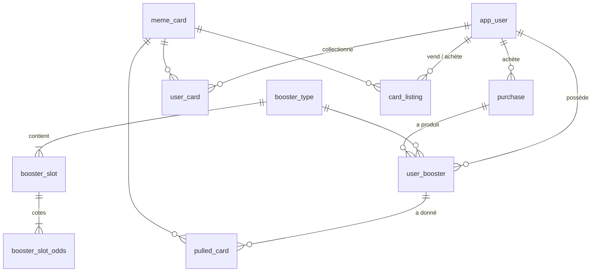

# Chasing Clout

Jeu de cartes à collectionner en ligne autour de 300 mèmes : on achète des boosters avec une monnaie virtuelle (les
*memes*), on les ouvre en 3D, on complète sa collection et on échange ses cartes avec les autres joueurs sur un marché.

Le projet tient en deux dépôts :
- **`chasing-clout-api`** (ce dépôt) : l'API REST, en Java 17 / Spring Boot 3.1 avec PostgreSQL
- **`chasing-clout-front`** : l'application web, en Angular 17, avec des scènes 3D en Three.js et GSAP

## Lancer le projet

Seul [Docker](https://docs.docker.com/get-docker/) est nécessaire (Docker Desktop, ou Docker Engine avec Compose v2).
Une commande construit et démarre la base de données (avec des comptes de démonstration), l'API et le front.

1. Cloner les deux dépôts **dans le même dossier** :
   ```
   git clone https://github.com/nassimJaz/chasing-clout-api.git
   git clone https://github.com/nassimJaz/chasing-clout-front.git
   ```
2. Depuis le dossier `chasing-clout-api` :
   ```
   docker compose -f docker-compose.demo.yml up -d --build --wait
   ```
   La première fois, compter quelques minutes (téléchargement des dépendances, construction de l'API et du front).
   La commande rend la main quand tout est prêt.
3. Ouvrir **http://localhost:4200** et se connecter avec un compte de démonstration.

| Pseudo | Mot de passe | Contenu |
|---|---|---|
| `prof` | `prof1234` | Plus de 10 000 memes, une collection déjà commencée (dont une carte Holo et une Enflammée), 4 boosters à ouvrir dont un tri-pack, une carte à soi en vente sur le marché, booster gratuit disponible |
| `rival` | `rival1234` | 5 cartes rares en vente sur le marché |

Pour tester les échanges, se connecter avec `prof`, acheter une carte de `rival` sur le marché, puis se reconnecter avec
`rival`. On peut aussi créer son propre compte (« Créer un compte ») : un nouveau joueur reçoit 5000 memes.

- **Arrêter** : `docker compose -f docker-compose.demo.yml down` (les données sont conservées)
- **Repartir de zéro** : `docker compose -f docker-compose.demo.yml down -v`, puis relancer l'étape 2
- **Port 4200 déjà utilisé** : `DEMO_PORT=8000 docker compose -f docker-compose.demo.yml up -d --build --wait`, puis
  http://localhost:8000 (sous PowerShell : `$env:DEMO_PORT=8000` avant la commande)

### Sans Docker (mode développement)
Prérequis : Docker pour la base seule, Java 17, Maven, Node 18 ou 20.
1. `cp .env.sample .env`, puis remplir `.env` : identifiants de la base au choix, et `JWT_SECRET` (au moins 32 caractères,
   par exemple `openssl rand -base64 48`)
2. `docker compose up -d` : base vide (tables, boosters et 300 cartes, aucun joueur)
3. `mvn spring-boot:run` : API sur http://localhost:8080 (`application.properties` lit le `.env`)
4. Dans `chasing-clout-front` : `npm i` puis `npm start`, application sur http://localhost:4200 ; créer un compte

### Lancer l'API avec Docker (développement)
Avec un `.env` rempli (dont `JWT_SECRET`), `docker compose up -d --build` démarre la base **et** l'API sur
http://localhost:8080, sans données de démonstration. Arrêter d'abord une API lancée en local (`mvn spring-boot:run` ou
IntelliJ) : les deux utilisent le port 8080.

## Fonctionnalités
- **Comptes** : inscription, connexion et déconnexion. Chaque joueur démarre avec 5000 memes.
- **Boutique** : trois boosters (Basic 100, Spécial 250, Collection 500 memes), à l'unité, en tri-pack ou en display de 9,
  30 ou 60 boosters ; un booster sur trois est à -60 %. Les displays de 30 et 60 existent aussi en mixte 50/50 de deux boosters.
- **Ouverture en 3D** : le paquet se déchire et les cartes se retournent une à une ; un tri-pack ou un display s'ouvre comme une box.
- **Raretés et finitions** : chaque carte a une rareté fixe (6 niveaux, de Commune à Secrète) ; à chaque tirage, une
  finition est tirée en plus : Normale (94 %), Holo (5 %) ou Enflammée (1 %).
- **Collection** : les 300 cartes, grisées tant qu'on ne les possède pas, chacune visible en 3D.
- **Marché** : mettre une carte en vente au prix de son choix, acheter celles des autres, retirer son annonce. Le système
  rachète aussi n'importe quelle carte à 30 % de son prix (il n'en vend pas) ; ce prix suit les ventes récentes entre joueurs.
- **Booster gratuit** toutes les 30 minutes.

## Architecture
```
Navigateur ──> front (nginx + Angular compilé) ──/api──> API Spring Boot ──> PostgreSQL
```
Avec Docker, seul le front est exposé : nginx sert l'application et relaie `/api` et les images (`/memes`) vers l'API.

| | Technologies |
|---|---|
| Front | Angular 17, RxJS, Three.js et GSAP pour la 3D |
| API | Java 17, Spring Boot 3.1, Spring Security (JWT), Spring Data JPA / Hibernate 6, springdoc (Swagger) |
| Base | PostgreSQL |
| Tests | JUnit 5, Mockito, MockMvc, spring-security-test |
| Lancement | Docker, Docker Compose |

Code de l'API (`src/main/java/com/takima/backskeleton/`) : `controllers/` (routes REST), `services/` (règles du jeu),
`DAO/` (accès à la base), `models/` (entités JPA), `DTO/` (formes des réponses), `SecurityConfig` (règles d'accès et JWT),
`DemoData` (comptes de démonstration, profil Spring `demo`).

## Choix techniques
- **Authentification sans état par JWT** : `/auth/login` et `/auth/register` renvoient un jeton signé (HS256, valable 24 h)
  qui contient l'id du joueur ; le front l'envoie dans l'en-tête `Authorization: Bearer`. Les mots de passe sont hachés
  avec BCrypt. Le catalogue et la consultation du marché sont publics ; tout le reste exige un jeton valide (sinon 401).
- **Concurrence gérée par la base** : tout ce qui touche à l'argent ou à une action unique (débit, ouverture d'un booster,
  achat d'une annonce, booster gratuit) est une seule requête SQL atomique, qui échoue proprement si la condition n'est
  plus vraie. Si deux joueurs achètent la même carte au même moment, un seul l'obtient ; un solde ne peut pas devenir négatif.
- **Séquestre** : une carte mise en vente quitte la collection de son vendeur et y revient si l'annonce est retirée.
- **Prix calculés à la lecture** : prix de base = rareté × finition, rapproché de la moyenne des 10 dernières ventes entre
  joueurs (à partir de 3 ventes) sans jamais la dépasser. Toujours à jour, sans tâche planifiée.
- **Booster gratuit** : le délai de 30 minutes est vérifié avec l'horloge de la base, jamais avec celle du navigateur.
- **Images servies par l'API**, car les liens du dataset d'origine
  ([not-lain/meme-dataset](https://huggingface.co/datasets/not-lain/meme-dataset)) expirent.

## Modèle de données

Le schéma est écrit en SQL dans `initdb/` (exécuté par PostgreSQL au premier démarrage) ; Hibernate ne crée rien, il
vérifie au démarrage que les entités (`models/`) correspondent aux tables (`ddl-auto=validate`).



| Table | Rôle |
|---|---|
| `app_user` | Joueur (pseudo unique, mot de passe haché en BCrypt), son solde de *memes* (`CHECK >= 0`) et `last_free_booster_claim` (cooldown du booster gratuit) |
| `meme_card` | Les 300 cartes ; chacune a une rareté **fixe** |
| `booster_type` | BASIC (100), SPECIAL (250), COLLECTION (500) |
| `booster_slot` / `booster_slot_odds` | Slots d'un booster (nb de cartes) et poids de chaque rareté |
| `purchase` | Une commande en boutique (format, prix total) |
| `user_booster` | Inventaire de boosters ; `opened_at` null = pas encore ouvert |
| `pulled_card` | Historique : chaque carte tirée, avec sa finition et sa position |
| `user_card` | Collection : une ligne par (joueur, carte, finition) avec une quantité |
| `card_listing` | Marketplace P2P : annonce ACTIVE / SOLD / CANCELLED ; les lignes SOLD sont l'historique des ventes |

## API

Swagger (lancement sans Docker) : `http://localhost:8080/swagger-ui.html`. Toutes les réponses sont des DTO (`record` dans `DTO/`), jamais des entités.
CORS ouvert par `@CrossOrigin` sur les controllers. En cas d'erreur, le JSON contient un champ `message` lisible (« Solde insuffisant »…).

| Méthode | URL | Rôle |
|---|---|---|
| POST | `/auth/register` | Inscription : `{"username": "remi", "password": "motdepasse"}` → `{"token": "..."}`, 5000 memes. 409 si le pseudo est pris, 400 si pseudo (3 à 20 caractères : lettres, chiffres, `. _ -`) ou mot de passe (8 min.) invalide |
| POST | `/auth/login` | Connexion, même corps → `{"token": "..."}`. 401 si le pseudo ou le mot de passe est faux |
| GET | `/cards` | Les 300 cartes (`id`, `name`, `imageUrl`, `rarity`) |
| GET | `/boosters` | Les 3 boosters : `price`, `prices` par format, `slots` avec leurs poids. Mixte = `(prices[A] + prices[B]) / 2` |
| GET | `/me` | Profil du joueur (`username`, `memeBalance`, `nextFreeBoosterAt`) |
| POST | `/me/purchases` | Achat : `{"format": "DISPLAY_MEDIUM", "boosterTypeId": 1, "secondBoosterTypeId": 2}` (le 2e id est optionnel). 409 si solde insuffisant, 400 si mixte hors Medium/Méga |
| GET | `/me/boosters` | Boosters non ouverts (`id`, `code`, `name`) |
| POST | `/me/boosters/{id}/open` | Ouvre : cartes tirées dans l'ordre (`position`, `card`, `finish`). 409 si déjà ouvert ou pas au joueur |
| GET | `/me/cards` | Collection : (`card`, `finish`, `quantity`, `firstObtainedAt`) |
| POST | `/me/free-booster` | Booster Basic gratuit (non ouvert). 429 si le dernier date de moins de 30 min ; `GET /me` donne `nextFreeBoosterAt` |
| GET | `/market/prices/{cardId}` | Pour chaque finition : prix de base système (`price`) et prix de rachat (`buyback`) |
| POST | `/market/system-sales` | Vente d'une carte au système : `{"memeCardId": 1, "finish": "HOLO"}` → montant crédité. 409 si la carte n'est pas possédée |
| GET | `/market/listings` | Annonces actives, moins chères d'abord (`card`, `finish`, `price`, `seller`) |
| POST | `/market/listings` | Mettre en vente : `{"memeCardId": 1, "finish": "NORMAL", "price": 300}`. 409 si la carte n'est pas possédée |
| DELETE | `/market/listings/{id}` | Retirer son annonce (la carte revient). 409 si déjà vendue ou pas à soi |
| POST | `/market/listings/{id}/purchase` | Acheter une annonce. 409 si déjà vendue, à soi, ou solde insuffisant |

Toutes les routes `/me/...` et les écritures `/market/...` demandent `Authorization: Bearer <token>` (401 sans jeton valide).

## Tests
`mvn test`, avec la base lancée (mode développement, étapes 1 et 2).
- **Tests unitaires**, sans base : probabilités des tirages (1 million de tirages par cas), prix des formats et du marché,
  inscription et connexion (`AuthServiceTest`, base simulée avec Mockito).
- **Tests d'intégration**, sur la vraie base et annulés à la fin : boutique, ouverture, marché, parcours complets par
  HTTP (MockMvc), protection des routes par le jeton, données de démonstration.
- **Tests de concurrence**, avec de vrais threads : deux acheteurs pour la même annonce (un seul gagne), cinq demandes
  simultanées de booster gratuit (une seule passe).

## Limites connues
- La déconnexion se fait côté navigateur : un jeton reste valable jusqu'à son expiration (24 h).
- Les corps de requête ne sont pas tous validés : un champ manquant dans un achat renvoie une erreur 500 (le front envoie toujours tous les champs).
- Swagger ne permet pas de saisir le jeton : les routes protégées se testent depuis le front ou avec curl.
- Pas de tests automatisés côté front.

Notes de développement (installation détaillée, déroulé du projet, pièges rencontrés) : [`DEVELOPPEMENT.md`](DEVELOPPEMENT.md).
