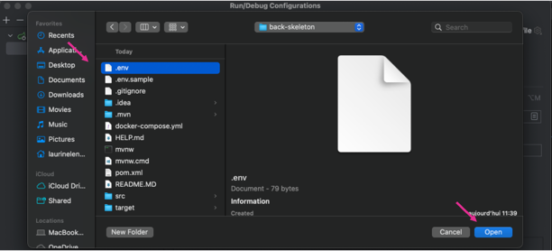
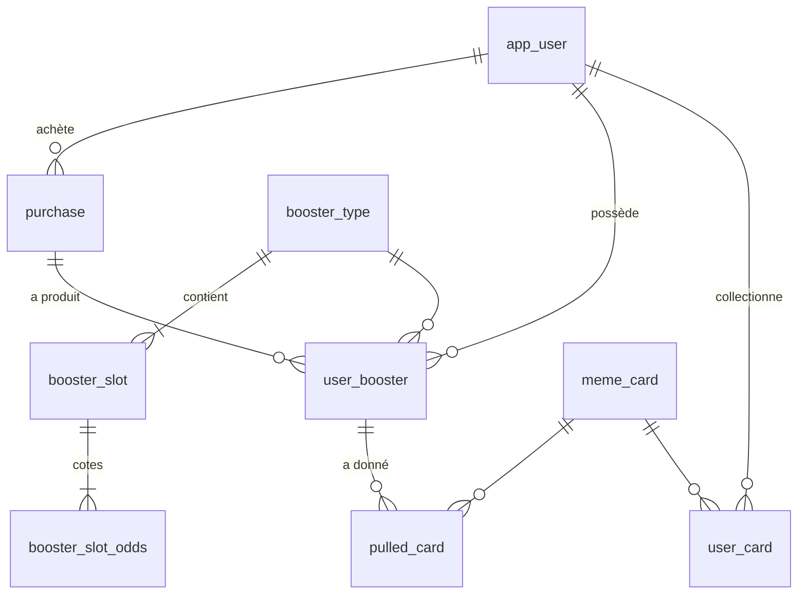

# Chasing Clout — API

Jeu de cartes à collectionner (TCG) basé sur les 300 mèmes du dataset
[not-lain/meme-dataset](https://huggingface.co/datasets/not-lain/meme-dataset).
Back : Java 17, Spring Boot 3.1, JPA/Hibernate 6, PostgreSQL. Front : Angular 17 (repo `chasing-clout-front`).

## Set up
1. Copie-colle le `.env.sample` en `.env`
2. Remplis le fichier `.env` avec les credentials de ton choix (`DATABASE_PORT=5432` par défaut ; change-le si un autre Postgres utilise déjà ce port)
3. Fais un `docker compose up -d` : crée la base et exécute `initdb/*.sql` (tables, boosters, 300 cartes, utilisateur `demo`)
   - Les scripts ne tournent **que sur un volume vide**. Après une modif SQL : `docker compose down -v` puis `docker compose up -d`
4. Rajoute le plugin : [env-file](https://plugins.jetbrains.com/plugin/7861-envfile)
5. Ajoute ton fichier `.env` comme ci-dessous (n'oublie pas d'activer les fichiers cachés)

6. Lance `BackSkeletonApplication`. Les images des cartes sont servies sur `http://localhost:8080/memes/<slug>.jpg`

## Modèle de données

Le schéma est écrit en SQL dans `initdb/` ; Hibernate est en `ddl-auto=validate` : il ne crée rien, il vérifie au
démarrage que les entités (`models/`) correspondent aux tables. Les noms de tables/colonnes viennent de la naming
strategy de Spring Boot (`AppUser` → `app_user`, `memeBalance` → `meme_balance`), d'où l'absence de `@Table`/`@Column`.

| Table | Rôle |
|---|---|
| `app_user` | Joueur et son solde de *memes* (`CHECK >= 0`) |
| `meme_card` | Les 300 cartes ; chacune a une rareté **fixe** |
| `booster_type` | BASIC (100), SPECIAL (250), COLLECTION (500) |
| `booster_slot` / `booster_slot_odds` | Slots d'un booster (nb de cartes) et poids de chaque rareté |
| `purchase` | Une commande en boutique (format, prix total) |
| `user_booster` | Inventaire de boosters ; `opened_at` null = pas encore ouvert |
| `pulled_card` | Historique : chaque carte tirée, avec sa finition et sa position |
| `user_card` | Collection : une ligne par (joueur, carte, finition) avec une quantité |

## Choix de conception
- **Rareté sur la carte, finition sur le tirage.** Les 300 mèmes sont répartis 100 Commun / 75 Peu commun / 55 Rare /
  40 Très rare / 20 Ultra rare / 10 Secrète (mélange à graine fixe, voir `scripts/import_memes.py`). La finition
  (Normale 94 %, Holo 5 %, Enflammée 1 %) est tirée pour chaque carte, cf. l'enum `Finish`.
- **Cotes en poids relatifs**, pas en pourcentages : `(60, 30, 10)`, et `(1, 1, 1)` pour les 33,33 % du Booster Collection.
- **La concurrence est gérée par la base**, via 3 requêtes atomiques :
  `AppUserDao.debit` (pas de solde négatif), `UserBoosterDao.markOpened` (un booster ne s'ouvre qu'une fois),
  `UserCardDao.addOne` (upsert de la collection). Toujours passer par elles.
- **Images en statique** dans `src/main/resources/static/memes/` : les URLs du dataset Hugging Face expirent.
  `scripts/import_memes.py` (Python stdlib) régénère les images et `initdb/3_CARDS.sql` ; ne pas éditer ce fichier à la main.
- **Prix et économie** (valeurs de départ, modifiables dans `2_DEFAULT_ENTRIES.sql`) : Basic 100, Spécial 250,
  Collection 500 ; l'utilisateur `demo` démarre avec 5000 memes.

### Règles décidées pour la suite
- **Remise** : sur `n` boosters, `n / 3` (division entière) sont à -60 %, soit `prix × 40 / 100` (les prix sont multiples de 5, donc ça tombe juste).
- **Mixte 50/50** : seulement pour Display Medium (15 + 15, 5 remisés par type) et Display Méga (30 + 30, 10 par type) ;
  1, 3 et 9 boosters ne se coupent pas en deux moitiés égales.
- **Achat ≠ ouverture** : acheter crée des `user_booster` non ouverts, l'ouverture est un appel séparé.
- **Pas d'authentification pour l'instant** : on travaille avec l'utilisateur `demo` (id 1).

## Avancement

- [x] **Phase 0 — Socle** : `initdb/` monté dans Docker, port configurable, conteneur renommé `chasing_clout_db`, Hibernate en `validate`
- [x] **Phase 0 bis — Supprimer l'exemple du squelette** (Student/Major/Course : modèles, DAO, services, controllers, DTO) : vérifié, `mvn test` (contextLoads) passe sur un Postgres neuf en `validate`
- [x] **Phase 1 — Import du dataset** : 300 images + `initdb/3_CARDS.sql`
- [x] **Phase 2 — Schéma, entités JPA, DAO** : vérifié sur un Postgres neuf (scripts OK, contraintes et upsert OK, Spring démarre en `validate`, images servies)
- [x] **Phase 3 — `GachaService` (ouverture d'un booster) + tests** : vérifié, `mvn test` passe (7 tests) sur la base lancée
  - `GachaService.open(userId, userBoosterId)` : `markOpened` d'abord (sinon `ResponseStatusException` 409),
    puis pour chaque slot rareté pondérée → carte uniforme dans la rareté → finition pondérée ; `PulledCard` (positions 1..n) + `addOne`.
  - Bean `RandomGenerator` dans `BackSkeletonApplication` (graine fixe possible en test).
  - `GachaServiceTest` (sans base) : fréquences sur 1M tirages de `pickWeighted` à ±0,2 % pour (60, 30, 10), (1, 1, 1) et les finitions.
  - `GachaServiceIntegrationTest` (base requise, rollback) : 10 / 10 / 12 cartes, positions, rareté permise par le slot,
    collection incrémentée, deuxième ouverture refusée.
- [x] **Phase 4 — Boutique (`ShopService`)** : vérifié, `mvn test` passe (19 tests) sur la base lancée
  - `ShopService.buy(userId, format, boosterTypeId, secondBoosterTypeId)` : `secondBoosterTypeId` non null = mixte 50/50
    (Display Medium/Méga seulement, sinon 400) ; `debit` d'abord (sinon 409 « Solde insuffisant »), puis `Purchase` + `n` `UserBooster` non ouverts.
  - `ShopService.price(unitPrice, count)` : `count / 3` boosters à -60 % ; en mixte, appliqué à chaque moitié.
  - `ShopServiceTest` (sans base) : prix des 5 formats et des mixtes. `ShopServiceIntegrationTest` (base requise, rollback) :
    débit et boosters créés, mixte 15 + 15, solde insuffisant (rien n'est acheté), mixte refusé hors Medium/Méga.
- [ ] **Phase 5 — API REST** : boutique, inventaire, ouverture, collection, profil ; DTO en `record` Java (ne plus renvoyer les entités directement)
- [ ] **Phase 6 — Front Angular** : Boutique, Inventaire, Ouverture (révélation animée, effets CSS holo/feu), Collection (filtres par rareté) ; retirer les pages Student/Major
- [ ] **Phase 7 — Finitions** : URL de l'API dans `environment.ts`, CORS, README du front

### Points ouverts
- Quelques noms du dataset sont douteux pour un projet d'école (ex. « Pedobear ») : à filtrer ou renommer dans `scripts/import_memes.py` si besoin.
- Les tests `*IntegrationTest` et `BackSkeletonApplicationTests` (contextLoads) ont besoin de la base lancée.
- Après `AppUserDao.debit` (requête de masse), un `AppUser` déjà chargé dans la même transaction garde l'ancien solde : le relire après un `clear()`.
- `./mvnw` ne marche pas (dossier `.mvn/wrapper/` absent du repo) : utiliser un Maven installé (`mvn`) ou celui d'IntelliJ.

## Reprendre le projet avec Claude Code
- `CLAUDE.md` importe ce README : Claude le lit automatiquement au démarrage d'une session dans ce repo.
- Plugin [Ponytail](https://github.com/DietrichGebert/ponytail) (pousse l'IA à écrire le code le plus simple possible) :
  déclaré dans `.claude/settings.json`, Claude Code propose de l'installer au premier lancement dans ce repo (accepter le
  marketplace puis le plugin). À défaut : `/plugin marketplace add DietrichGebert/ponytail` puis `/plugin install ponytail@ponytail`.
- Exemple de prompt : *« Lis le README et attaque la phase 3 »*. À la fin de chaque phase, cocher la case ci-dessus et noter ce qui a été vérifié.
