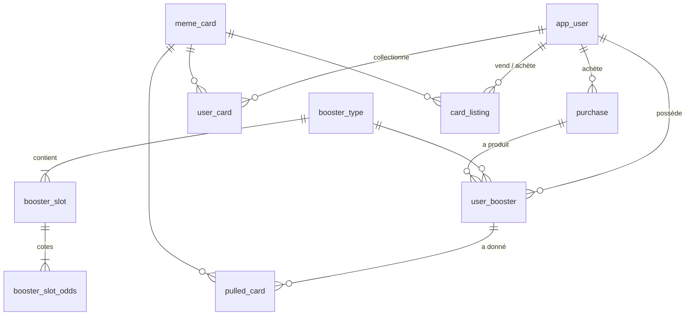

# Chasing Clout (API)

## Sommaire
1. [Présentation](#présentation)
2. [Prérequis](#prérequis)
3. [Lancer avec Docker](#lancer-avec-docker)
   - [Démo complète (base + API + front)](#démo-complète-base--api--front)
   - [Stack de développement (base + API)](#stack-de-développement-base--api)
4. [Développer avec IntelliJ](#développer-avec-intellij)
5. [Migrations SQL](#migrations-sql)
6. [Fonctionnalités](#fonctionnalités)
7. [Architecture](#architecture)
8. [Choix techniques](#choix-techniques)
9. [Modèle de données](#modèle-de-données)
10. [API (routes)](#api-routes)
11. [Tests](#tests)
12. [Limites connues](#limites-connues)
13. [Comment nous avons utilisé l'IA (Claude Code)](#comment-nous-avons-utilisé-lia-claude-code)

## Présentation

Jeu de cartes à collectionner en ligne autour de 300 mèmes. On achète des boosters avec une monnaie virtuelle (les
*memes*), on les ouvre carte par carte, on complète sa collection et on échange ses cartes avec les autres joueurs.

- **3 boosters** : Basic (100), Spécial (250), Collection (500 memes)
- **5 formats d'achat** : `SINGLE` (1), `TRI_PACK` (3), `DISPLAY_MINI` (9), `DISPLAY_MEDIUM` (30), `DISPLAY_MEGA` (60)
- **6 raretés** (Commune à Secrète) et **3 finitions** tirées à chaque carte : `NORMAL`, `HOLO`, `FIRE` (Enflammée)
- **Collection**, **marché entre joueurs**, **rachat par le système à 30 %** du prix de la carte
- **Booster gratuit** toutes les 30 minutes
- **Authentification JWT**

Le projet tient en deux dépôts :
- **`chasing-clout-api`** (ce dépôt) : l'API REST, Java 17 / Spring Boot 3.1.3 / PostgreSQL
- **`chasing-clout-front`** : l'application web, Angular 17, avec des scènes 3D en Three.js et GSAP

## Prérequis

Pour lancer le projet :
- **Docker** avec **Docker Compose v2** (Docker Desktop, ou Docker Engine + plugin Compose)
- **Git**

Pour développer en plus :
- **JDK 17** (`<java.version>17</java.version>` dans `pom.xml` ; un JDK plus récent compile aussi en cible 17)
- **IntelliJ IDEA** (l'équipe travaille avec)
- **Maven** : celui intégré à IntelliJ, ou un Maven installé (`mvn`). **`./mvnw` ne fonctionne pas dans ce dépôt** : le
  script est là mais le dossier `.mvn/wrapper/` manque, il échoue avec `Could not find or load main class
  org.apache.maven.wrapper.MavenWrapperMain`.

## Lancer avec Docker

Deux fichiers Compose, pour deux usages différents :

| Fichier | Contenu | Pour qui |
|---|---|---|
| `docker-compose.demo.yml` | base + API + front, comptes de démonstration | qui veut tester l'application |
| `docker-compose.yml` | base + API, sans données de démonstration | qui développe |

### Démo complète (base + API + front)

Rien d'autre que Docker n'est nécessaire, pas de `.env`.

1. Cloner les deux dépôts **dans le même dossier** (le Compose de démo construit le front depuis `../chasing-clout-front`) :
   ```bash
   git clone https://github.com/nassimJaz/chasing-clout-api.git
   git clone https://github.com/nassimJaz/chasing-clout-front.git
   ```
2. Depuis `chasing-clout-api` :
   ```bash
   docker compose -f docker-compose.demo.yml up -d --build --wait
   ```
   La première fois, compter quelques minutes (dépendances, construction de l'API et du front). Avec `--wait`, la
   commande rend la main quand le compte `prof` peut se connecter.
3. Ouvrir **http://localhost:4200** et se connecter :

| Pseudo | Mot de passe | Contenu |
|---|---|---|
| `prof` | `prof1234` | Plus de 10 000 memes, une collection déjà commencée (dont une carte Holo et une Enflammée), 4 boosters à ouvrir dont un tri-pack, une carte à soi en vente sur le marché, booster gratuit disponible |
| `rival` | `rival1234` | 5 cartes rares en vente sur le marché |

Pour tester les échanges : se connecter avec `prof`, acheter une carte de `rival` sur le marché, puis se reconnecter avec
`rival`. On peut aussi créer son compte (« Créer un compte ») : un nouveau joueur reçoit 5000 memes.

- **Arrêter** (données conservées) : `docker compose -f docker-compose.demo.yml down`
- **Repartir de zéro** : `docker compose -f docker-compose.demo.yml down -v`, puis relancer l'étape 2
- **Port 4200 déjà pris** : `DEMO_PORT=8000 docker compose -f docker-compose.demo.yml up -d --build --wait`, puis
  http://localhost:8000 (PowerShell : `$env:DEMO_PORT=8000` avant la commande)

Dans la démo, seul le front est exposé : la base et l'API ne sont pas joignables depuis la machine hôte.

### Stack de développement (base + API)

1. Créer le `.env` à partir du modèle :
   ```bash
   cp .env.sample .env
   ```
2. Le remplir :
   ```properties
   DATABASE_USER=root
   DATABASE_PASSWORD=un-mot-de-passe
   DATABASE_NAME=chasing_clout
   DATABASE_PORT=5432
   JWT_SECRET=<au moins 32 caractères, par exemple : openssl rand -base64 48>
   ```
   `JWT_SECRET` est **obligatoire** : sans lui, `docker compose` s'arrête avec l'erreur `add JWT_SECRET to .env`.
   Si un autre Postgres utilise déjà le port 5432, changer `DATABASE_PORT`.
3. Lancer :
   ```bash
   docker compose up -d --build     # base (conteneur chasing_clout_db) + API sur http://localhost:8080
   docker compose up -d database    # la base seule (pour lancer l'API depuis IntelliJ)
   ```
   Au premier démarrage, la base exécute `initdb/*.sql` : tables, 3 boosters, 300 cartes, aucun joueur (on s'inscrit
   depuis le front ou avec `POST /auth/register`).
4. Front en local (dans `../chasing-clout-front`) : `npm i` puis `npm start`, sur http://localhost:4200.

Swagger : http://localhost:8080/swagger-ui.html.

## Développer avec IntelliJ

1. **Ouvrir le projet** : *File > Open* sur le dossier `chasing-clout-api`, IntelliJ importe le `pom.xml` (Maven).
   Choisir un JDK 17 dans *Project Structure > SDK*.
2. **Démarrer la base seule** : `docker compose up -d database` (avec le `.env` rempli, voir plus haut).
3. **Arrêter le conteneur `api`** s'il tourne (`docker compose stop api`) : il occupe le port 8080.
4. **Configuration de lancement** : *Run > Edit Configurations > + > Spring Boot* (ou *Application*), classe principale
   `com.takima.backskeleton.BackSkeletonApplication`, répertoire de travail = racine du dépôt.
5. **Variables d'environnement** : `DATABASE_HOST=localhost`, `DATABASE_PORT`, `DATABASE_NAME`, `DATABASE_USER`,
   `DATABASE_PASSWORD`, `JWT_SECRET`, avec les mêmes valeurs que le `.env`. Deux façons :
   - le plugin [EnvFile](https://plugins.jetbrains.com/plugin/7861-envfile) : onglet *EnvFile* de la configuration,
     cocher *Enable* et ajouter le `.env` (afficher les fichiers cachés pour le voir) ;
   - ou coller les variables dans le champ *Environment variables* (`DATABASE_PORT=5432;DATABASE_NAME=...`).

   En pratique, `application.properties` importe aussi le `.env` lui-même
   (`spring.config.import=optional:file:.env[.properties]`) et `DATABASE_HOST` vaut `localhost` par défaut : si le
   répertoire de travail est la racine du dépôt, l'API trouve ses variables même sans cette étape.
6. **Lancer** `BackSkeletonApplication` : API sur http://localhost:8080, images des cartes sur
   `http://localhost:8080/memes/<slug>.jpg`.

**Tests depuis IntelliJ** : clic droit sur `src/test/java` > *Run 'All Tests'* (ou `mvn test`). Les tests d'intégration et
de concurrence utilisent **la base configurée dans le `.env`**, c'est-à-dire la base de dev. Ils créent leurs propres
joueurs et annulent ou nettoient ce qu'ils écrivent, mais pour ne prendre aucun risque, les pointer vers une base jetable
(un autre `DATABASE_NAME` / `DATABASE_PORT` dans les variables de la configuration de test).

## Migrations SQL

Le schéma vit dans `initdb/`, exécuté par PostgreSQL **uniquement sur un volume vide**, dans l'ordre :

| Script | Contenu |
|---|---|
| `1_TABLES.sql` | les tables |
| `2_DEFAULT_ENTRIES.sql` | les 3 boosters, leurs slots et cotes initiales |
| `3_CARDS.sql` | les 300 cartes |
| `4_MARKETPLACE.sql` | le marché entre joueurs et le booster gratuit |
| `5_RARITY_ODDS.sql` | cotes durcies des slots rares |

Sur une base **déjà créée**, un nouveau script ne s'exécute pas tout seul : l'appliquer à la main, par exemple :
```bash
docker exec -i chasing_clout_db psql -U <DATABASE_USER> -d <DATABASE_NAME> -v ON_ERROR_STOP=1 < initdb/5_RARITY_ODDS.sql
```
Autre option, qui efface les données : `docker compose down -v` puis `docker compose up -d database`.

Règles : ne jamais modifier un script existant, en ajouter un nouveau (`6_...sql`) ; Hibernate est en
`ddl-auto=validate`, donc une entité qui ne correspond plus aux tables empêche l'API de démarrer.

## Fonctionnalités
- **Comptes** : inscription, connexion, déconnexion. Chaque joueur démarre avec 5000 memes.
- **Boutique** : 3 boosters (Basic 100, Spécial 250, Collection 500 memes), à l'unité, en tri-pack ou en display de 9, 30
  ou 60 ; un booster sur trois est à -60 %. Les displays de 30 et 60 existent aussi en mixte 50/50 de deux boosters.
- **Ouverture** : le front déchire le paquet et retourne les cartes une à une ; un tri-pack ou un display s'ouvre comme une box.
- **Raretés et finitions** : chaque carte a une rareté fixe (6 niveaux) ; à chaque tirage, une finition est tirée en
  plus : Normale (94 %), Holo (5 %) ou Enflammée (1 %).
- **Collection** : les 300 cartes, grisées tant qu'on ne les possède pas.
- **Marché** : mettre une carte en vente au prix de son choix, acheter celles des autres, retirer son annonce. Le système
  rachète n'importe quelle carte à **30 %** de son prix, mais n'en vend aucune.
- **Booster gratuit** (Basic) toutes les 30 minutes.

### Cotes des raretés

Chaque booster a des slots : 6 cartes dans le slot 1, 4 dans le slot 2, et 2 de plus dans le slot 3 pour Collection.
Poids actuels (`initdb/2_DEFAULT_ENTRIES.sql`, modifiés par `initdb/5_RARITY_ODDS.sql`) :

| Booster | Slot | Commune | Peu commune | Rare | Très rare | Ultra rare | Secrète |
|---|---|---|---|---|---|---|---|
| Basic | 1 (6 cartes) | 60 | 30 | 10 | | | |
| Basic | 2 (4 cartes) | | | 1013 | 180 | 6 | 1 |
| Spécial | 1 (6 cartes) | 40 | 30 | 30 | | | |
| Spécial | 2 (4 cartes) | | | 244 | 150 | 5 | 1 |
| Collection | 1 (6 cartes) | 1 | 1 | 1 | | | |
| Collection | 2 (4 cartes) | | | 60 | 40 | | |
| Collection | 3 (2 cartes) | | | | 74 | 5 | 1 |

Espérance par booster :

| Booster | Ultra rare | Secrète |
|---|---|---|
| Basic | 1 sur 50 | 1 sur 300 |
| Spécial | 1 sur 20 | 1 sur 100 |
| Collection | 1 sur 8 | 1 sur 40 |

Prix système d'une carte = prix de la rareté (5, 10, 25, 60, 150, 400) × multiplicateur de finition (Normale ×1, Holo ×4,
Enflammée ×15). Avec ces cotes et un rachat à 30 %, revendre au système tout le contenu d'un booster rapporte moins que
son prix, même en display (vérifié par un test, voir [Tests](#tests)).

## Architecture
```
Navigateur ──> front (nginx + Angular compilé) ──/api──> API Spring Boot ──> PostgreSQL
```
Dans la démo Docker, nginx sert l'application et relaie `/api` et les images (`/memes`) vers l'API.

| | Technologies |
|---|---|
| Front | Angular 17, RxJS, Three.js et GSAP |
| API | Java 17, Spring Boot 3.1.3, Spring Security (JWT via le resource server OAuth2 / Nimbus), Spring Data JPA / Hibernate 6, springdoc 2.2 (Swagger) |
| Base | PostgreSQL |
| Tests | JUnit 5, Mockito, MockMvc, spring-security-test |
| Lancement | Docker, Docker Compose |

Code de l'API (`src/main/java/com/takima/backskeleton/`) :
- `controllers/` : routes REST (`AuthController`, `CatalogController`, `MeController`, `MarketController`)
- `services/` : règles du jeu (`AuthService`, `ShopService`, `GachaService`, `MarketService`)
- `DAO/` : accès à la base (Spring Data, requêtes SQL atomiques)
- `models/` : entités JPA et enums (`Rarity`, `Finish`, `PurchaseFormat`…)
- `DTO/` : formes des requêtes et réponses (`record`)
- `SecurityConfig` : règles d'accès et JWT ; `DemoData` : comptes de démonstration (profil Spring `demo` uniquement)

## Choix techniques
- **Authentification sans état par JWT** : `/auth/login` et `/auth/register` renvoient un jeton signé (HS256, valable
  24 h) qui contient l'id du joueur ; le front l'envoie dans `Authorization: Bearer`. Mots de passe hachés en BCrypt.
  Le catalogue, la consultation du marché et les images sont publics ; tout le reste exige un jeton (sinon 401).
- **Concurrence gérée par la base** : tout ce qui touche à l'argent ou à une action unique (débit, ouverture d'un
  booster, achat d'une annonce, booster gratuit) est une seule requête SQL atomique, qui échoue proprement si la
  condition n'est plus vraie. Deux joueurs qui achètent la même carte en même temps : un seul l'obtient. Un solde ne
  peut pas devenir négatif (`CHECK >= 0`).
- **Séquestre** : une carte mise en vente quitte la collection du vendeur et y revient si l'annonce est retirée.
- **Prix calculés à la lecture** : prix de base = rareté × finition ; à partir de 3 ventes entre joueurs, il remonte de
  30 % de l'écart vers 95 % de la moyenne des 10 dernières ventes, sans jamais la dépasser ni descendre sous le prix de
  base. Pas de tâche planifiée.
- **Rachat à 30 %, pas de vente par le système** : assez bas pour qu'ouvrir des boosters et tout revendre fasse perdre
  des memes ; les cartes ne s'achètent qu'entre joueurs.
- **Booster gratuit** : le délai de 30 minutes est vérifié avec l'horloge de la base, jamais celle du navigateur.
- **Schéma en SQL** (`initdb/`), Hibernate en `validate` : rien n'est généré automatiquement.
- **Images servies par l'API**, car les liens du dataset d'origine
  ([not-lain/meme-dataset](https://huggingface.co/datasets/not-lain/meme-dataset)) expirent.

## Modèle de données



| Table | Rôle |
|---|---|
| `app_user` | Joueur (pseudo unique, mot de passe BCrypt), solde de *memes* (`CHECK >= 0`), `last_free_booster_claim` (délai du booster gratuit) |
| `meme_card` | Les 300 cartes ; chacune a une rareté **fixe** |
| `booster_type` | BASIC (100), SPECIAL (250), COLLECTION (500) |
| `booster_slot` / `booster_slot_odds` | Slots d'un booster (nombre de cartes) et poids de chaque rareté |
| `purchase` | Une commande en boutique (format, prix total) |
| `user_booster` | Inventaire de boosters ; `opened_at` null = pas encore ouvert |
| `pulled_card` | Historique : chaque carte tirée, avec sa finition et sa position |
| `user_card` | Collection : une ligne par (joueur, carte, finition) avec une quantité |
| `card_listing` | Marché : annonce ACTIVE / SOLD / CANCELLED ; les lignes SOLD servent d'historique des ventes |

## API (routes)

Swagger : http://localhost:8080/swagger-ui.html (stack de dev ou IntelliJ). Toutes les réponses sont des DTO (`record`
dans `DTO/`), jamais des entités. CORS ouvert par `@CrossOrigin` sur les controllers. En cas d'erreur, le JSON contient un
champ `message` lisible (« Solde insuffisant »…).

| Méthode | URL | Rôle |
|---|---|---|
| POST | `/auth/register` | Inscription : `{"username": "remi", "password": "motdepasse"}` → `{"token": "..."}`, 5000 memes. 409 si le pseudo est pris, 400 si pseudo (3 à 20 caractères : lettres, chiffres, `. _ -`) ou mot de passe (8 min.) invalide |
| POST | `/auth/login` | Connexion, même corps → `{"token": "..."}`. 401 si pseudo ou mot de passe faux |
| GET | `/cards` | Les 300 cartes (`id`, `name`, `imageUrl`, `rarity`) |
| GET | `/boosters` | Les 3 boosters : `price`, `prices` par format, `slots` avec leurs poids. Mixte = `(prices[A] + prices[B]) / 2` |
| GET | `/me` | Profil (`username`, `memeBalance`, `nextFreeBoosterAt`) |
| POST | `/me/purchases` | Achat : `{"format": "DISPLAY_MEDIUM", "boosterTypeId": 1, "secondBoosterTypeId": 2}` (2e id optionnel). 409 si solde insuffisant, 400 si mixte hors Medium / Méga |
| GET | `/me/boosters` | Boosters non ouverts (`id`, `code`, `name`) |
| POST | `/me/boosters/{id}/open` | Ouvre : cartes tirées dans l'ordre (`position`, `card`, `finish`). 409 si déjà ouvert ou pas au joueur |
| GET | `/me/cards` | Collection (`card`, `finish`, `quantity`, `firstObtainedAt`) |
| POST | `/me/free-booster` | Booster Basic gratuit (non ouvert). 429 si le dernier date de moins de 30 min |
| GET | `/market/prices/{cardId}` | Pour chaque finition : prix de base (`price`) et prix de rachat à 30 % (`buyback`) |
| POST | `/market/system-sales` | Vente au système : `{"memeCardId": 1, "finish": "HOLO"}` → montant crédité. 409 si la carte n'est pas possédée |
| GET | `/market/listings` | Annonces actives, moins chères d'abord (`card`, `finish`, `price`, `seller`) |
| POST | `/market/listings` | Mettre en vente : `{"memeCardId": 1, "finish": "NORMAL", "price": 300}`. 409 si la carte n'est pas possédée |
| DELETE | `/market/listings/{id}` | Retirer son annonce (la carte revient). 409 si déjà vendue ou pas à soi |
| POST | `/market/listings/{id}/purchase` | Acheter une annonce. 409 si déjà vendue, à soi, ou solde insuffisant |

Routes publiques : `/auth/**`, `GET /cards`, `GET /boosters`, `GET /market/**`, `GET /memes/**`, Swagger. Toutes les
autres demandent `Authorization: Bearer <token>`.

Essai rapide avec curl :
```bash
curl -H 'Content-Type: application/json' -d '{"username":"essai","password":"motdepasse"}' localhost:8080/auth/register
curl -H "Authorization: Bearer <token>" localhost:8080/me
```

## Tests

`mvn test` (ou depuis IntelliJ), avec la base lancée. Attention : ils tournent sur la base du `.env` (voir
[Développer avec IntelliJ](#développer-avec-intellij)).

- **Tests unitaires**, sans base : fréquences des tirages comparées aux poids (`GachaServiceTest`), prix des formats
  (`ShopServiceTest`), prix du marché (`MarketServiceTest`), inscription et connexion avec une base simulée par Mockito
  (`AuthServiceTest`).
- **Tests d'intégration** (`@SpringBootTest`, annulés à la fin) : achat et ouverture (`ShopServiceIntegrationTest`,
  `GachaServiceIntegrationTest`), marché, rachat à 30 % et booster gratuit (`MarketServiceIntegrationTest`), parcours
  HTTP complets et protection des routes par le jeton (`ApiIntegrationTest`, `AuthApiIntegrationTest`), données de
  démonstration (`DemoDataTest`).
- **Garde-fou économique** : `ShopServiceIntegrationTest.resellingABoosterToTheSystemLosesMemes` lit les cotes en base et
  vérifie que, pour chaque booster, la valeur de revente attendue au système reste inférieure à son prix en display.
- **Tests de concurrence** (`MarketConcurrencyTest`, vrais threads) : deux acheteurs pour la même annonce (un seul
  gagne), cinq demandes simultanées de booster gratuit (une seule passe).

## Limites connues
- La déconnexion se fait côté navigateur : un jeton reste valable jusqu'à son expiration (24 h).
- Les corps de requête ne sont pas tous validés : un champ manquant dans un achat renvoie une erreur 500 (le front envoie
  toujours tous les champs).
- Swagger ne permet pas de saisir le jeton : les routes protégées se testent depuis le front ou avec curl.
- Les tests d'intégration ont besoin d'une base et utilisent celle du `.env` ; le `Dockerfile` les saute (`-DskipTests`).
- `./mvnw` ne fonctionne pas (dossier `.mvn/wrapper/` absent) : utiliser `mvn` ou le Maven d'IntelliJ.
- Pas de tests automatisés côté front.

## Comment nous avons utilisé l'IA (Claude Code)

Nous avons développé le projet avec [Claude Code](https://docs.anthropic.com/en/docs/claude-code). Cette section décrit
comment, et ce qui reste de notre ressort.

### C'est l'équipe qui fixe les objectifs

Nous travaillons en **mode plan** de Claude Code. Pour chaque fonctionnalité, nous écrivons et validons un plan **avant
toute ligne de code** : ce que l'on veut, les contraintes, les critères de réussite.

1. Nous décrivons l'objectif et les contraintes.
2. Claude propose un plan d'implémentation (fichiers touchés, étapes, tests).
3. Nous le validons, le corrigeons ou le rejetons.
4. Claude exécute le plan validé.
5. Nous relisons le résultat : tests, appels curl, diff.

Claude ne décide pas de ce qu'il faut faire. Les décisions produit ont été prises par l'équipe : les raretés et leurs
cotes, le rachat par le système à 30 %, l'absence de vente par le système.

### Organisation

- **Une session Claude par dépôt** (API, front) : chacune charge nativement le `CLAUDE.md` et les skills de son dépôt.
- **Une session de coordination**, ouverte au-dessus des deux dépôts, qui rédige les plans transverses et relit le
  travail des deux autres, sans modifier le code elle-même.
- `CLAUDE.md` importe ce README et `DEVELOPPEMENT.md`, et fixe les règles de travail (schéma uniquement par `initdb/`,
  style des packages, pas de Lombok).

### Skills et plugins (`.claude/`)

| Outil | À quoi il sert | Pourquoi | Dans quel contexte |
|---|---|---|---|
| Skill `chasing-clout-backend` (`.claude/skills/chasing-clout-backend/SKILL.md`), écrit pour ce dépôt | Comment lancer, tester et modifier le backend : commandes, procédure pour changer le schéma (nouveau script `initdb/`, application sur la base existante, vérification sur un Postgres jetable), conventions de code (requête SQL atomique pour tout ce qui peut entrer en concurrence, DTO en `record`, messages d'erreur en français), et un tableau des pièges déjà rencontrés (port 5432 pris par un autre Postgres, `JWT_SECRET` manquant, mot de passe Postgres changé après la création du volume, cache JPA après une requête `@Modifying`, tests qui dépendaient d'un vrai joueur de la base de dev, `mvn` plutôt que `./mvnw`) | Éviter de redécouvrir les mêmes problèmes à chaque session et garder un code homogène | Chargé automatiquement pour toute tâche backend : ajout d'une route, d'une table, lancement des tests, API qui ne démarre pas |
| Plugin `superpowers` (`superpowers@claude-plugins-official`) | Bibliothèque de skills de méthode : écriture et exécution de plans, TDD, débogage systématique, vérification avant de déclarer une tâche finie, revue de code, worktrees git | Cadrer la manière de travailler de Claude : un plan, des tests, une vérification réelle plutôt qu'une affirmation | Rédaction des plans, corrections de bugs, fin de chaque tâche |
| Plugin `ponytail` (`ponytail@ponytail`, marketplace `DietrichGebert/ponytail`) | Pousse vers la solution la plus simple qui fonctionne : se demander si le code est nécessaire, préférer la bibliothèque standard et les fonctions natives aux dépendances | Limiter le code superflu et les abstractions inutiles qu'un assistant a tendance à ajouter | Toute écriture de code ; les commentaires `// ponytail:` dans le code signalent une simplification assumée et sa limite (ex. déconnexion sans liste de révocation dans `AuthService`) |

Les deux plugins sont déclarés dans `.claude/settings.json` : Claude Code propose de les installer à l'ouverture du
dépôt (installation manuelle : voir `DEVELOPPEMENT.md`).

### Exemples d'utilisation réelle

- **Fusion des branches sans risque** : avant de fusionner, vérification avec `git merge-tree` que la fusion ne produit
  aucun conflit, sans toucher à la copie de travail.
- **Compose de développement** : ajout du service `api` à `docker-compose.yml` à côté de la base, avec l'arrêt explicite
  si `JWT_SECRET` manque.
- **Rééquilibrage des raretés** : script `5_RARITY_ODDS.sql` (auparavant, un display Collection donnait environ 24
  Secrètes alors qu'il n'en existe que 10) et test qui vérifie qu'aucun booster n'est rentable à la revente au système.
- **Migrations testées à part** : chaque nouveau script SQL a d'abord été exécuté sur un conteneur Postgres jetable
  avant d'être appliqué à la base de développement.

Notes de développement (déroulé du projet par phases, décisions de conception, pièges rencontrés) :
[`DEVELOPPEMENT.md`](DEVELOPPEMENT.md).
